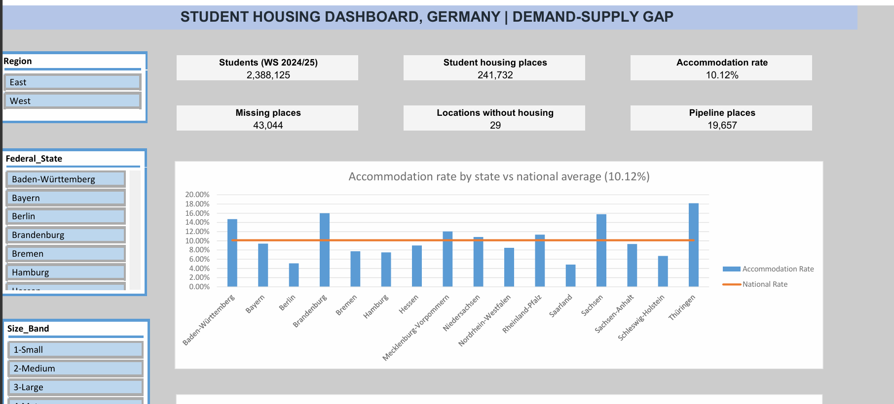
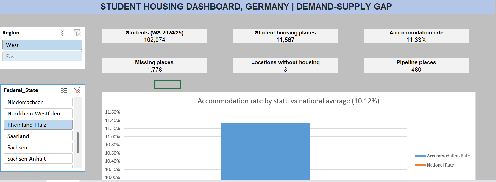
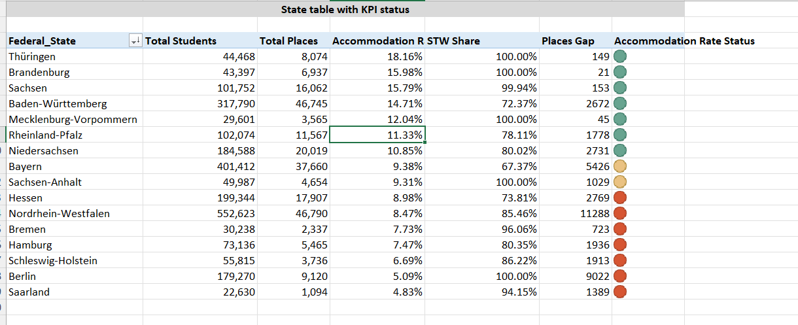
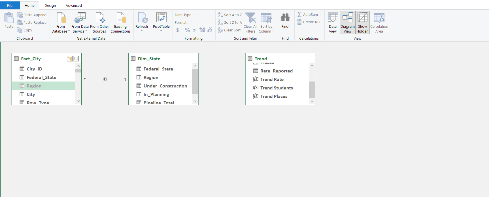
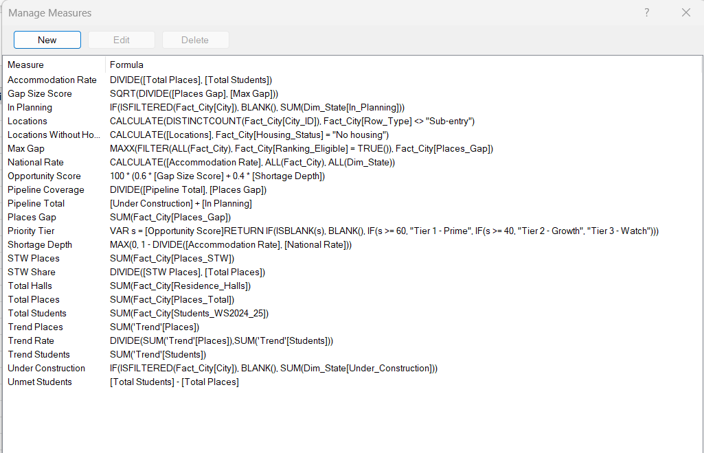

# Student Housing Gap Analysis, Germany
### Demand–Supply Gap & Market Opportunity Dashboard (Excel)



Business intelligence project built **entirely in Microsoft Excel** (Power Query, Data Model, DAX, PivotTables, PivotCharts, Slicers, KPI). It turns the published statistics of the *Deutsches Studierendenwerk* into a decision tool that shows **where Germany is short of student housing, how big the shortage is, and whether housing pipeline will fix it.**

---

## Problem

Student numbers in Germany rose far faster than publicly funded housing over the last three decades. A **student-accommodation provider, developer, investor** has to decide where to build or expand first.

This project answers one core question:

> **Which German states and university locations have the largest unmet demand for student housing, and will the current construction pipeline close the gap?**

---
## Dashboard

The **Dashboard** sheet contains:

- **6 KPI cards:** students, housing places, accommodation rate, missing places, locations without housing, pipeline places
- **5 charts:** rate by state vs national benchmark, top 10 missing places, students vs places 1991–2025, pipeline vs missing places by state, accommodation rate trend 1991–2025
- **3 slicers:** Region, Federal State, Size Band

The **Calc** sheet holds the 12 PivotTables that feed the dashboard, including the state scorecard (with KPI status icons), the Top 10 Opportunity Score ranking, the white-spot list, the East vs West table, the size-band summary and the pipeline coverage table.

---
## Filtered Dashboard Overview (by federal state: Rheinland-Pfalz)

## State pivottable summary with KPI Icons

## Data model preview

## DAX Measures Overview Table

---

## Business questions answered

| # |  Question | Short answer | Where to see it |
|---|---|---|---|
| 1 | How well supplied is each state compared with the national average? | 7 states are above the 10.12% national rate, 2 are close, 7 are clearly below. Thüringen leads (18.2%), Saarland is last (4.8%). | Rate-by-state chart, state scorecard with KPI status |
| 2 | How large is the shortage overall? | About **43,000 places** are missing if every location were brought up to the national average. That is 17.8% on top of today's stock. | "Missing places" KPI card |
| 3 | Where is the shortage concentrated? | **North Rhine-Westphalia, Berlin and Bavaria hold 60%** of the national gap. The 10 largest location gaps make up 51%. | Top 10 missing places chart |
| 4 | Which locations should be prioritised? | Berlin is the only large-scale priority. Garching, Ismaning, Sankt Augustin, Saarbrücken and several smaller campuses follow. | Opportunity Score ranking (Calc sheet) |
| 5 | Where do students have no housing at all? | **29 locations with 27,381 students** have no publicly funded place. | White-spot table (Calc sheet), KPI card |
| 6 | Is there a real East–West difference? | Yes: East 14.6% vs West 9.6%, and East housing is almost entirely run by the Studierendenwerke (99.97% vs 77.8%). | East vs West table |
| 7 | Has supply kept up with student growth? | No. Students grew 45% since 1991, places fell 1.8%. The national rate dropped from 14.9% to 10.1%. | Rate trend and students-vs-places charts |
| 8 | Will the pipeline close the gap? | Only partly. 19,657 places are under construction or planned, which covers **46%** of the gap, and the biggest gaps are the worst covered. | Pipeline vs missing places chart |

## Key findings

1. **The system is under-supplied by about 43,000 places** against its own national average (10.12%), concentrated in a handful of regions.
2. **Berlin is the single largest problem.** It holds 7.5% of students but only 3.8% of places, a gap of 9,022 places (21% of the national gap), and its pipeline of 666 places covers just 7%.
3. **NRW is the largest gap by volume** (11,288 places, 26% of the national total) with only 40% pipeline coverage.
4. **State averages hide local shortages.** Baden-Württemberg (14.7%), Niedersachsen (10.8%) and Rheinland-Pfalz (11.3%) are all above the national rate yet still contain 1,800 to 2,700 missing places each. Koblenz, for example, sits at 3.8% inside a "green" state.
5. **Size of the university town does not explain supply.** Supply rates are almost flat across size bands (9.9% to 11.1%). Location and state housing policy matter more than city size.
6. **The East's advantage is a legacy, and it is shrinking.** East German supply fell from 86% of students in 1991 to 14.6% today, but it is still the best supplied region. Brandenburg, Mecklenburg-Vorpommern and Sachsen have pipelines that exceed their gap several times over.
7. **The recent rate improvement is mostly a falling student count, not new building.** Since 2021 the rate rose from 9.45% to 10.12%, while students fell by 148,761 and places grew by only 2,048.
8. **Bavaria is the only large state where the pipeline almost matches the gap** (97% coverage, 3,947 places already under construction).

## Dataset

| | |
|---|---|
| **Source** | Deutsches Studierendenwerk (DSW), *Wohnraum für Studierende, Statistische Übersicht 2025* |
| **Reference date** | 1 January 2025 (students: winter semester 2024/25) |
| **Coverage** | 218 location records in 16 federal states, plus a 1961–2025 time series |


| Table | Grain | Content |
|---|---|---|
| `Fact_City` | One row per university location | Halls, places, Studierendenwerke places, wheelchair places, students, reported rate |
| `Dim_State` | One row per federal state | Region (East/West), places under construction, places in planning |
| `Trend` | Year × region | Students, places and rate for West, East and Germany, 1961–2025 |

## Method and Excel skills used

| Stage | What was done | Excel feature |
|---|---|---|
| **1. Load and clean** | Imported three tables, set data types, replaced blanks with zero, built calculated columns: `Size_Band`, `Housing_Status`, `Places_Gap`, `Places_Private`, `Ranking_Eligible`. A `National_Rate` parameter holds the benchmark. | Power Query |
| **2. Model** | One-to-many relationship `Dim_State → Fact_City`. `Trend` is a standalone table. | Data Model (Power Pivot) |
| **3. Calculate** | Measures for rates, shares, gaps, pipeline coverage and the Opportunity Score. | DAX |
| **4. Analyse** | 12 PivotTables with Top 10 and value filters, plus a KPI object with traffic-light status for each state. | PivotTables, Power Pivot KPI |
| **5. Present** | Dashboard with KPI cards, linked PivotCharts and slicers. | PivotCharts, Slicers, conditional formatting |

---
## DAX measures

| DAX Measure Name | Formula | Definition and Purpose |
|---|---|---|
| `Total Students` | `SUM(Fact_City[Students_WS2024_25])` | Number of students at the selected locations (winter semester 2024/25). It is the denominator of every rate and the demand side of the analysis. |
| `Total Places` | `SUM(Fact_City[Places_Total])` | Number of publicly funded student housing places. It is the supply side of the analysis. |
| `STW Places` | `SUM(Fact_City[Places_STW])` | Places operated by the Studierendenwerke, the public student services organisations. Used to compare public and other providers. |
| `Total Halls` | `SUM(Fact_City[Residence_Halls])` | Number of student residence halls (complexes managed under one name). Used in the East vs West comparison. |
| `Locations` | `CALCULATE(DISTINCTCOUNT(Fact_City[City_ID]), Fact_City[Row_Type] <> "Sub-entry")` | Counts university locations and leaves out sub-entries that are listed separately in the report (for example the Mannheim medical faculty). Used in the size-band summary. |
| `Locations Without Housing` | `CALCULATE([Locations], Fact_City[Housing_Status] = "No housing")` | Counts locations that have students but no publicly funded place. Feeds the "Locations without housing" KPI card (29). |
| `Accommodation Rate` | `DIVIDE([Total Places], [Total Students])` | Places per student, shown as a percentage. The main supply indicator of the project. It is always calculated as total places ÷ total students and never as an average of percentages. |
| `STW Share` | `DIVIDE([STW Places], [Total Places])` | Share of places run by the Studierendenwerke. Shows how dominant the public providers are (East 99.97% vs West 77.8%). |
| `National Rate` | `CALCULATE([Accommodation Rate], ALL(Fact_City), ALL(Dim_State))` | The Germany-wide accommodation rate (10.12%), with every slicer and filter removed. It is the fixed benchmark that each state and location is compared against. |
| `Places Gap` | `SUM(Fact_City[Places_Gap])` | Total missing places compared with the national rate. Each location's gap is calculated in Power Query as students × 10.12% − existing places, with a minimum of 0, and this measure adds them up (43,044 nationally). |
| `Under Construction` | `IF(ISFILTERED(Fact_City[City]), BLANK(), SUM(Dim_State[Under_Construction]))` | Places currently being built. The data exists only per state, so the measure is blank on city rows to avoid repeating the state figure. |
| `In Planning` | `IF(ISFILTERED(Fact_City[City]), BLANK(), SUM(Dim_State[In_Planning]))` | Places in the planning stage, with the same state-level logic as `Under Construction`. |
| `Pipeline Total` | `[Under Construction] + [In Planning]` | All future places, built and planned (19,657 nationally). Feeds the "Pipeline places" KPI card. |
| `Pipeline Coverage` | `DIVIDE([Pipeline Total], [Places Gap])` | Share of the gap that the pipeline would cover. Below 100% means a shortage remains, above 100% means the pipeline is larger than the need. |
| `Max Gap` | `MAXX(FILTER(ALL(Fact_City), Fact_City[Ranking_Eligible] = TRUE()), Fact_City[Places_Gap])` | The largest gap among the eligible locations (those with at least 2,000 students). It is the reference value that scales the gap part of the Opportunity Score. |
| `Gap Size Score` | `SQRT(DIVIDE([Places Gap], [Max Gap]))` | A score from 0 to 1 for the size of the market. The square root stops one very large location (Berlin) from pushing every other score close to zero. |
| `Shortage Depth` | `MAX(0, 1 - DIVIDE([Accommodation Rate], [National Rate]))` | How far a location is below the national average. 0 means at or above average, 1 means no housing at all. |
| `Opportunity Score` | `100 * (0.6 * [Gap Size Score] + 0.4 * [Shortage Depth])` | Priority score from 0 to 100. It combines market size (60%) and severity of the shortage (40%). The weights are an assumption and can be changed. |
| `Priority Tier` | `IF(ISBLANK([Opportunity Score]), BLANK(), IF([Opportunity Score] >= 60, "Tier 1 - Prime", IF([Opportunity Score] >= 40, "Tier 2 - Growth", "Tier 3 - Watch")))` | Turns the score into a label: Tier 1 at 60 or above, Tier 2 at 40 or above, otherwise Tier 3. |
| `Trend Rate` | `DIVIDE(SUM(Trend[Places]), SUM(Trend[Students]))` | Accommodation rate for each year and region (West, East, Germany) in the 1961–2025 time series. Used in the rate trend chart. |
| `Trend Students` | `SUM(Trend[Students])` | Student numbers over time. Used in the students vs places chart. |
| `Trend Places` | `SUM(Trend[Places])` | Housing places over time. Used in the students vs places chart. |
| `Accommodation Rate Status` | Power Pivot KPI (no formula): value `[Accommodation Rate]`, target `[National Rate]`, thresholds 90% and 100% | Traffic-light status for each state. Green is at or above the national rate, yellow is 90% to 100% of it, and red is below 90%. |

**Notes**
- `Places_Gap`, `Size_Band`, `Housing_Status` and `Ranking_Eligible` are calculated columns created in Power Query, not DAX measures.
- Filters on `Dim_State` flow to `Fact_City` through the one-to-many relationship. `Trend` is not related to the other tables, so the slicers do not affect the trend measures.

## Repository structure

```
germany-student-housing-dashboard/
├── README.md
├── data/
│   └── Germany_Student_Housing_Dataset_2025.xlsx   
├── dashboard/
│   └── Student Housing Dashboard.xlsx
├── Full Dashboard Screenshot PDF
└── screenshots/
    ├── dashboard_overview.png
    ├── dashboard_filtered.png
    ├── statescorecard_with_kpi.png
    ├── data_model_overview.png
    └── dax_measures_overview.png
```

## How to use

1. Download `dashboard/Student_Housing_Dashboard.xlsx` and open it in **desktop Excel for Windows**
2. Open the **Dashboard** sheet and click the slicers
3. Open the **Calc** sheet to see the supporting PivotTables and the Opportunity Score ranking.

## Limitations

- Only **publicly funded** housing is counted. Private operators and the free rental market are not in the data, so true supply is higher than shown.

Happy Learning :smile: